# Voice (phase 3)

The tablet becomes an Assist satellite: it records the microphone, Home Assistant runs the Assist pipeline (STT, conversation,
TTS), the tablet shows and speaks the answer. Everything runs over the existing sidecar WebSocket (see
[PROTOCOL.md](PROTOCOL.md)); no second connection, no port on the tablet.

## Slices

| Slice | What | State |
|---|---|---|
| 3.1 | Integration: `assist_satellite` entity, voice messages, announcements. Tested against a real Home Assistant with a fake tablet | done, see [TESTING.md](TESTING.md) |
| 3.2 | App: microphone capture, TTS playback, push-to-talk, answer page | done as v1 (full-screen page; the docked bubble over the dashboard is still to do) |
| 3.3 | Wake word on the device (openWakeWord models on LiteRT) | done, see below |
| 3.4 | Real conversations (listen again after an answer), timers by voice, `start_conversation` and `ask_question`, the redesigned screen | done, see below (skins and the docked bubble are not) |

## Design decisions

- **Home Assistant's own satellite API.** The entity subclasses `AssistSatelliteEntity` and calls
  `async_accept_pipeline_from_satellite`, so pipeline selection, VAD sensitivity, conversation ids, announcements and
  the Assist "satellite" automations work like for any other satellite. We do not run a pipeline ourselves.
- **Audio in: base64 PCM in JSON frames.** 16 kHz, mono, signed 16 bit little endian (what the pipeline expects), 80 ms per
  frame (1280 samples, about 3.4 KB of text, 12.5 frames per second; the size the wake word model works in). Binary frames would save a third of the bandwidth but need a second
  parser on both sides; revisit if a real network shows a problem.
- **Audio out: Home Assistant's TTS URL.** Home Assistant sends the URL (a signed `/api/tts_proxy/...` path), the tablet
  fetches it from the address it is already connected to and plays it. The tablet confirms when playback ended
  (`played`), which is what returns the entity from *responding* to *idle*.
- **One session at a time.** A new `start` cancels a running one (barge-in); a disconnect cancels it.
- **Push-to-talk first, wake word later.** `start` has an optional `wake_word` phrase for slice 3.3; without it the
  pipeline starts at STT.
- **The tablet stops recording when Home Assistant says so** (`stt-end`, or an error), not on its own VAD. Home Assistant
  already runs VAD (`pymicro_vad`) and the silence length is the entity's *VAD sensitivity* setting.

## Messages

Tablet to Home Assistant, all `{"type": "voice", "action": ..., "session": "<id chosen by the tablet>"}`:

| action | extra fields | meaning |
|---|---|---|
| `start` | `wake_word` (optional phrase) | begin a pipeline run, audio follows |
| `audio` | `data` (base64 PCM) | one frame |
| `stop` | | the tablet stopped recording (button released, timeout) |
| `cancel` | | abort the run |
| `played` | | the TTS answer finished playing |

Home Assistant to the tablet:

- `{"type": "voice_event", "session": id, "event": <pipeline event>, "data": {...}}` with the pipeline event names of
  Assist (`run-start`, `stt-start`, `stt-vad-start`, `stt-vad-end`, `stt-end`, `intent-start`, `intent-end`, `tts-start`,
  `tts-end`, `run-end`, `error`). `data` is trimmed to what the UI needs: `stt-end` `{text}`, `intent-end`
  `{text, continue_conversation}`, `tts-end` `{url}`, `error` `{code, message}`.
- Command `voice_announce` `{url, message, preannounce_url}`: play the sound, then the announcement; the result is sent when
  playback ended (so Home Assistant can block, as the satellite API requires).

State of the entity follows the pipeline: `idle`, `listening` (from `stt-start`), `processing` (from `intent-start`),
`responding` (from `tts-start` until `played`).

## Entities (per tablet, prefix `lab` as example)

`assist_satellite.lab_assist` (features: announce), `select.lab_assist_pipeline` (which Assist pipeline; *preferred* by
default) and `select.lab_assist_vad_sensitivity` (how long a pause ends the command). These are Home Assistant's own helper
selects, the satellite entity reads them like it does for ESPHome or VoIP devices.

## The app (slice 3.2)

- **Starting a turn:** *Talk to Assist* on the Home tab, the Home Assistant service `ha_sidecar.listen` (also the button
  *Start listening*, for a physical button or an automation) or, later, the wake word. `ha_sidecar.cancel_listening` ends it.
- **Recording:** `Voice.kt` records 16 kHz mono PCM16 with `AudioRecord` (source *voice recognition*) in a foreground
  service of type `microphone`, 80 ms per frame, with a level for the page. The page opens first, so the app is visible when the
  service starts (Android 14+ forbids starting a microphone service from the background). Recording ends on Home Assistant's
  `stt-end`/error, on *Done talking*, on cancel, or after 30 s.
- **Permission:** `RECORD_AUDIO`. A device owner grants it silently (also again after it was revoked); otherwise the
  permission dialog opens (`mic_permission` is the error shown meanwhile, with an *Allow the microphone* button).
- **Answer:** the TTS URL is fetched through the address the tablet is connected through (Home Assistant may name its internal
  address while the tablet is away), played with `MediaPlayer` (usage *assistant*, transient audio focus that lets other audio
  duck), `played` is sent when it ends.
- **The page** (`/voice`, an own Android activity like the alarm page, over the lock screen, keeps the screen on): state icon with a
  level ring, the recognised text, the answer, errors named by their stage (microphone, connection, speech recognition, playback),
  buttons *Done talking* / *Cancel*, double tap cancels. It closes itself 4 s after a turn (6 s after an error).
- **Safety:** a turn with no event from Home Assistant for 20 s is cancelled (`timeout`); losing the connection cancels it; a new
  turn interrupts the old one.

## Conversations (slice 3.4)

- **The loop.** A turn starts by wake word, the talk button or `ha_sidecar.listen`. Home Assistant's voice detection ends it when you stop
  talking, the answer is spoken, and then the tablet listens again by itself for a follow-up. The conversation ends when nothing is
  said within the follow-up window (8 s by default, 3 to 30 s), when you press *End conversation* (or the X, or double-tap), when
  Home Assistant or the microphone fails, or when the connection drops. The first listening after a wake word or tap waits 12 s for you
  to start. A follow-up is only offered after a *spoken* answer (a question to Home Assistant such as `ask_question` ends after the
  answer), and an answer that ends with a question (`continue_conversation`) always continues. Switch off with *Keep listening after an
  answer*; every listening is a normal run, so an LLM agent keeps its context (the entity keeps the conversation id).
- **Pings.** A rising ping (two quick notes) plays each time the tablet starts listening, a falling one when the conversation is over.
  They are synthesized (no sound files), played with the *assistant* audio usage, and the microphone opens only after the start ping so
  it is not recorded. Setting *Pings*, entity `switch.<prefix>_voice_pings`.
- **Is anybody talking?** The no-speech clock stops when Home Assistant reports `stt-vad-start` (its own voice detection), or when three
  microphone frames in a row are loud, for a pipeline that sends no such events. The screen shows the clock as a draining bar under
  the waveform.
- **Timers by voice.** "Set a timer for 3 minutes called pasta" is answered by Home Assistant's timer intents. The satellite registers as
  a timer device, so HA's timer manager hands the timer to the tablet, which counts, shows and rings it by itself (also when Home
  Assistant is away): started/updated become `start_timer` (an update restarts the timer with what is left and keeps its id, paused
  ones are paused), cancelled becomes `cancel_timer`, and a timer that the tablet missed rings at its end. Pause, resume, add time,
  cancel and "how long is left" by voice work the same way. A voice timer that is cancelled or dismissed on the tablet is cancelled in
  Home Assistant too. Timers made on the tablet or by
  `ha_sidecar.start_timer` are mirrored the other way: every running or paused countdown gets a twin in HA's timer manager (same label and
  time left, spoken as "8 minutes", not "480 seconds"), so "how long is left on my timer", pause, add time and cancel by voice work on them
  too and are carried out on the tablet. Changes on the tablet (paused, time added, finished, dismissed) are followed by re-creating the
  twin; HA's own events for a twin are not sent back. Stopwatches have no twin.
- **`start_conversation` and `ask_question`.** The entity now advertises *start conversation*: the tablet plays the (pre-announce
  sound and the) question, then listens by itself (command `voice_conversation`); `assist_satellite.ask_question` returns the matched answer
  (verified: `{id: yes, sentence: "yes please"}`). `start_conversation` itself needs an LLM conversation agent (HA refuses the built-in
  one), so it was not run end to end.
- **The screen** (`/voice`): a status chip (Listening, Listening for a follow-up, Thinking, Speaking, Problem), running timers as pills
  (a ring that empties, the time, the label; paused ones dimmed with a pause icon, finished ones red with the time over), a live
  waveform (the microphone level while listening, a ripple while thinking and speaking), and the conversation as chat bubbles: what you
  said on the right (three pulsing dots until Home Assistant has understood it), the answer on the left (a red bubble with the failing
  stage for errors), earlier turns of the same conversation dimmed above, the last three kept. Buttons: *Done talking*, *End
  conversation*; after an error or the end *Talk again* and *Close*. Not built: cards (weather, images, media) from the conversation
  log, and the draggable timer pills of the design notes.

### The screen, as it looks on the emulator

Screenshots from the lab run (tablet 2560x1800; the speech is synthetic, see [TESTING.md](TESTING.md)):

| | |
|---|---|
| 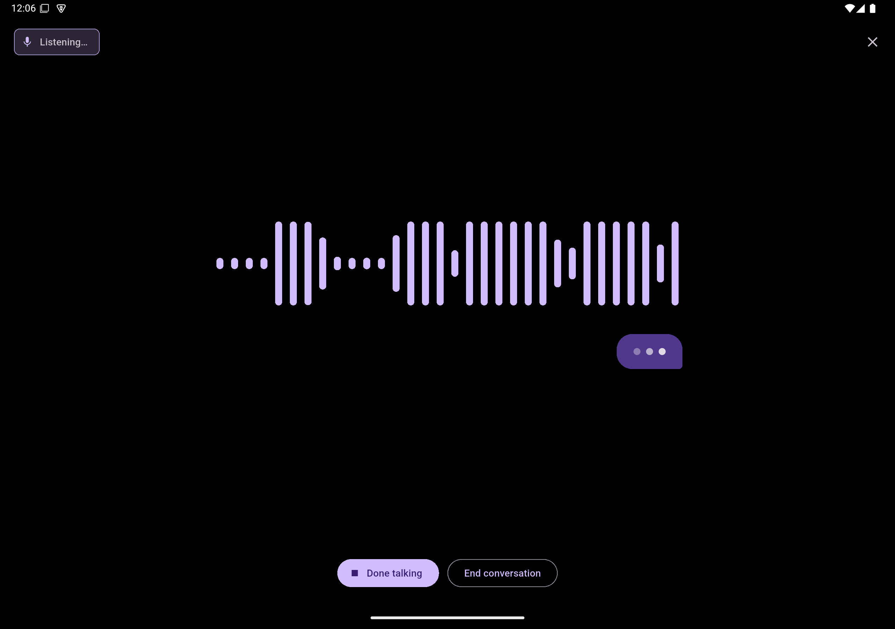 Listening: the waveform follows the microphone, a bubble waits for the words | 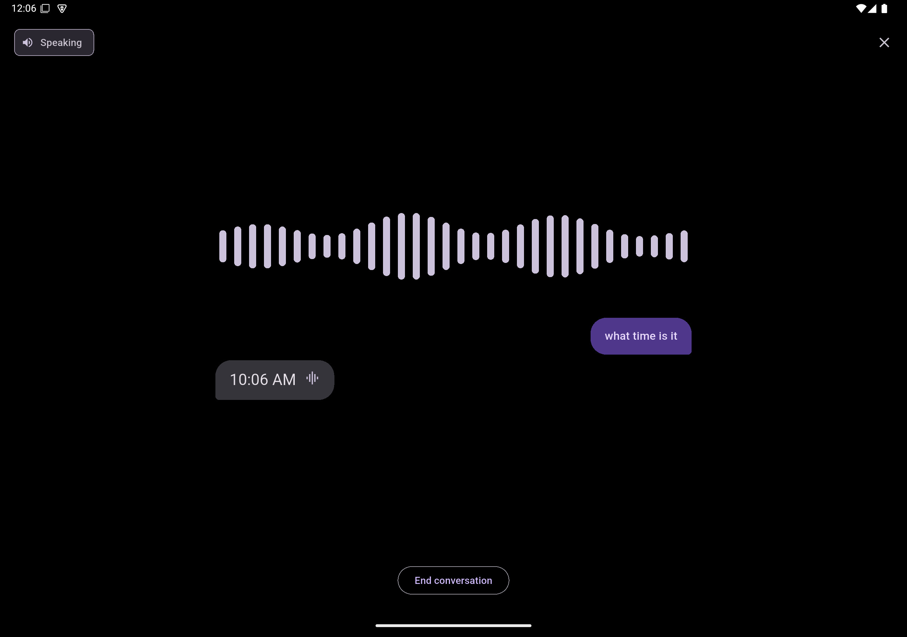 What you said (right) and the spoken answer (left) |
| 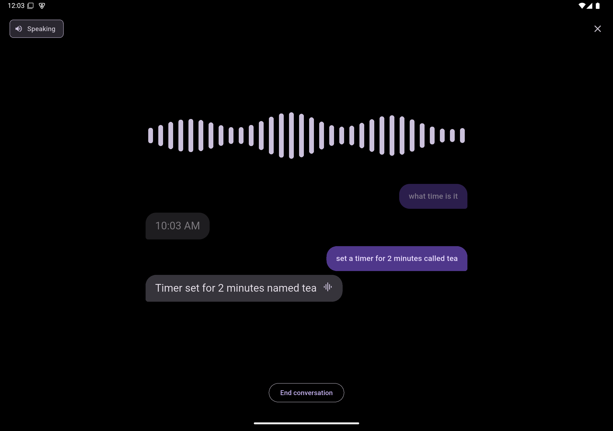 A second turn; the first stays dimmed above | 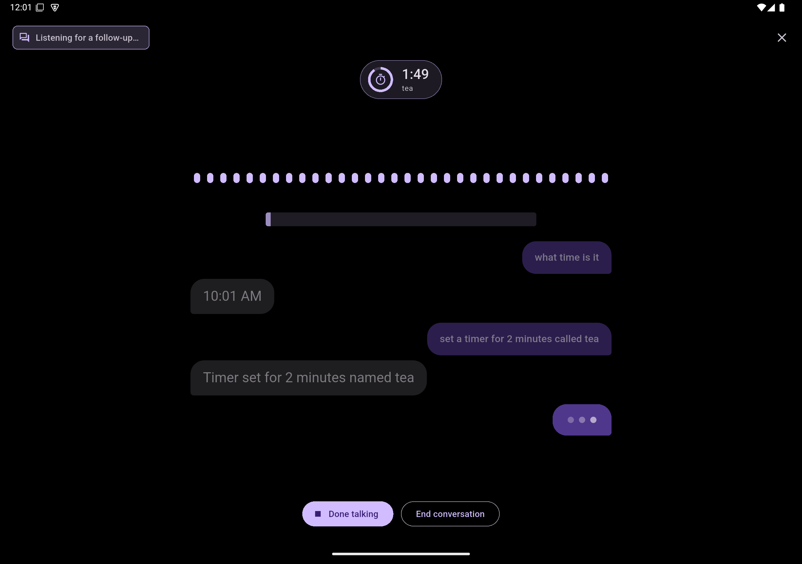 Listening for a follow-up: the bar drains, the timer pill keeps counting |
| 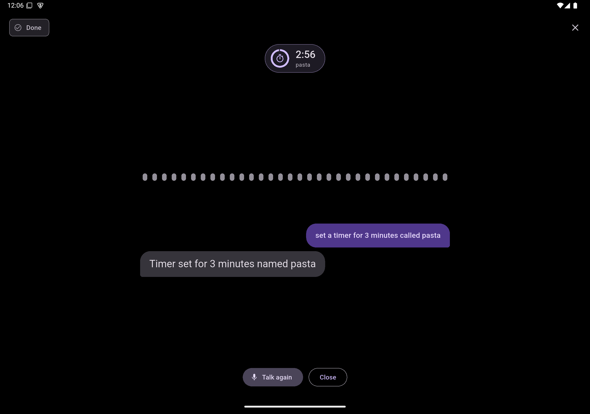 "Set a timer for 3 minutes called pasta" | 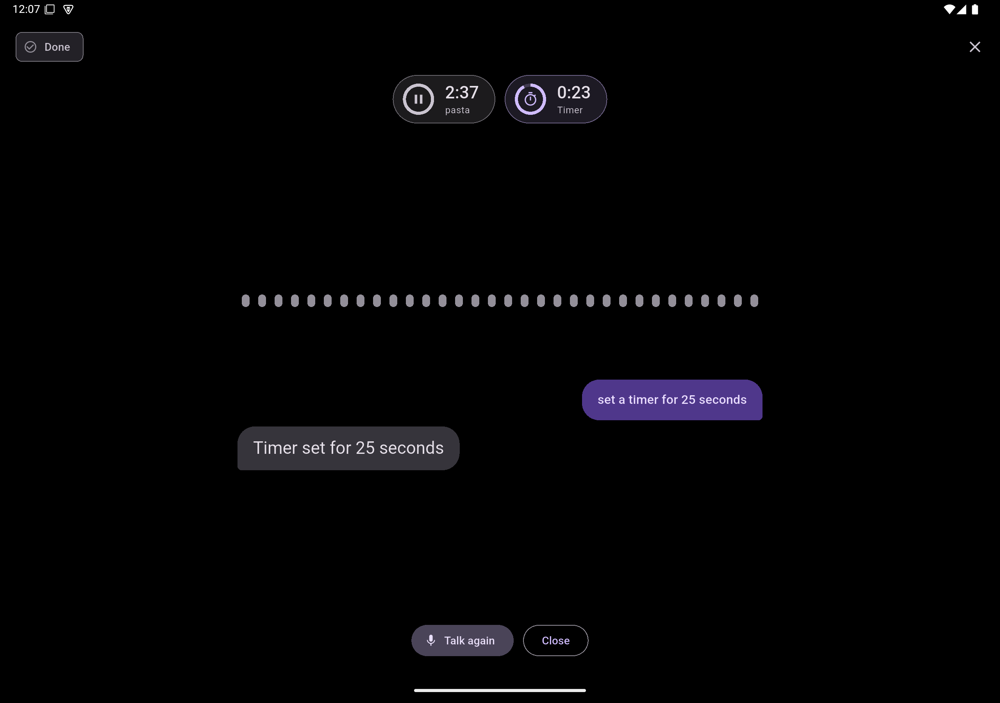 Two timers, one paused by voice |
| 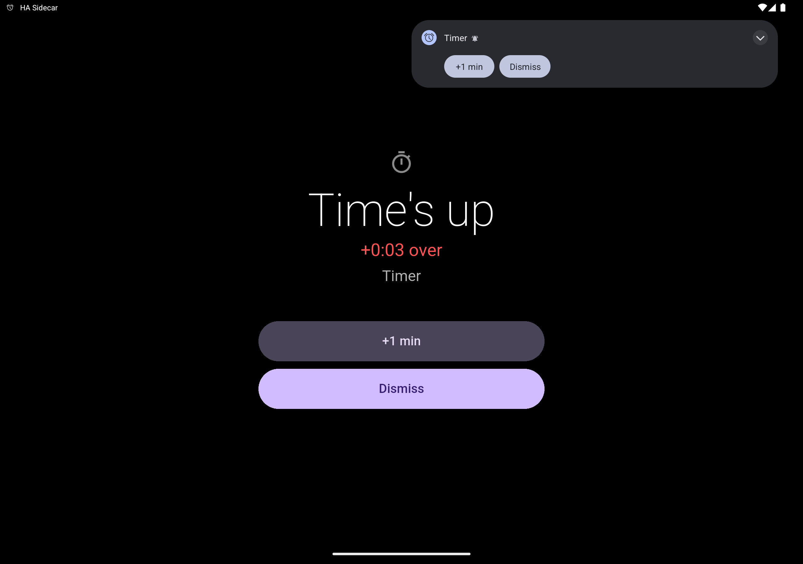 The voice timer rings by itself | 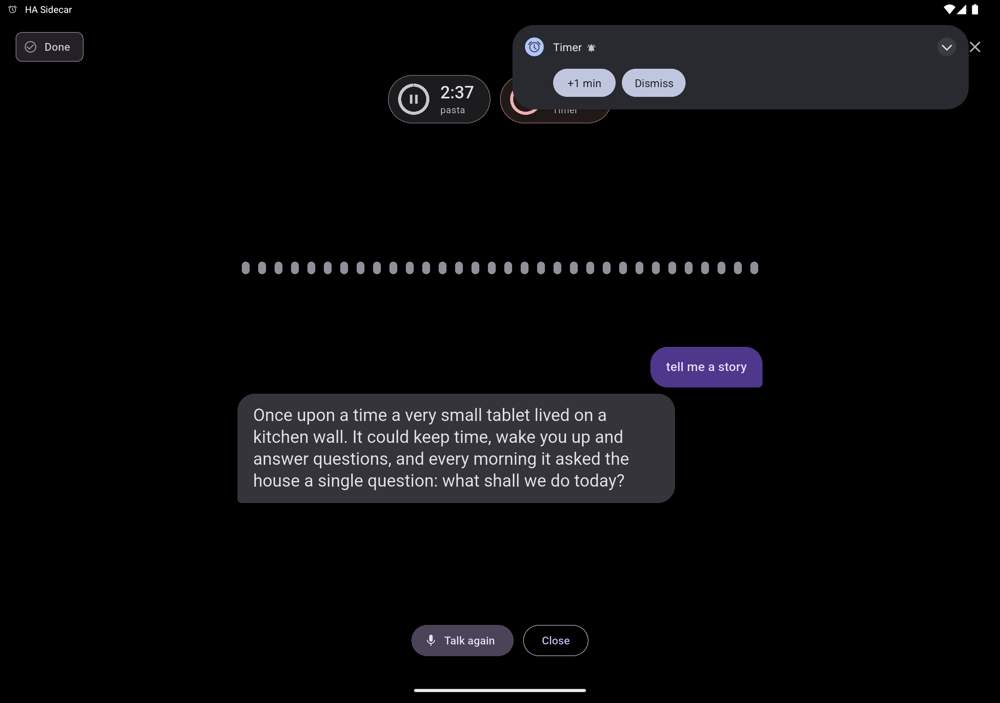 A long answer wraps in its bubble |
| 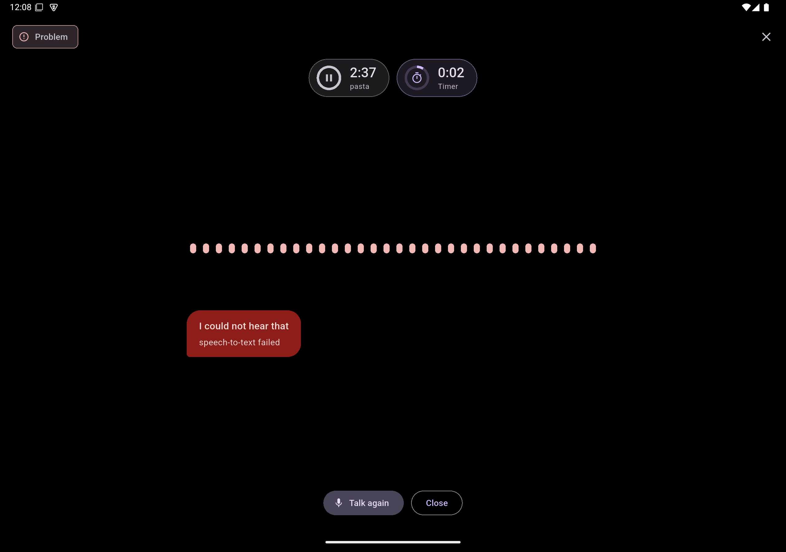 An error names what failed and offers to try again | 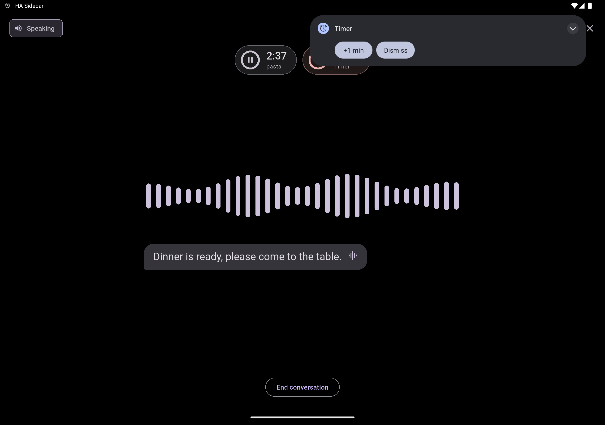 An announcement from Home Assistant |
| 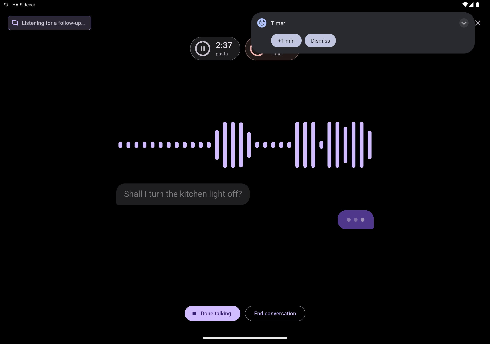 `ask_question`: the question stays, the answer is awaited | 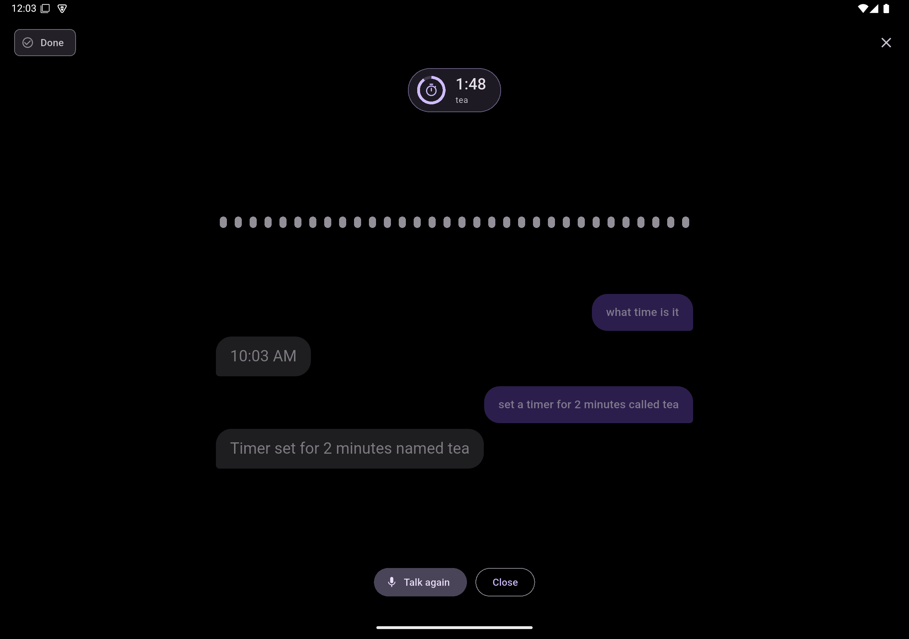 After a silence: Done, the conversation stays readable |

## Wake word (slice 3.3)

- **How it works:** the one microphone loop (`Voice.micLoop`) feeds 80 ms frames to the wake word engine while no turn is
  running (and to Home Assistant while one is). The engine is the openWakeWord pipeline: a mel spectrogram model, an embedding
  model and one small classifier per phrase, run with LiteRT 1.4 (`org.tensorflow.lite.Interpreter`). A score above the *Wake word
  threshold* (50 % by default) starts a turn exactly like the talk button, with the phrase passed to Home Assistant (`wake_word` in
  `start`); then the engine pauses, and for 2 s after the turn, so the answer is not heard as a new wake word.
- **Phrases (21):** Alexa, Hey Jarvis, Jarvis, OK Jarvis, Computer, OK Computer, Hey Mycroft, Hey Rhasspy, Hey Nabu, OK Nabu,
  Home Assistant, OK Home, Hey Friday, Marvin, Hey KITT, Hey Spock, Alfred, GLaDOS, Terminator, Mr. Anderson, Hey House. Several
  can be active at the same time (one classifier each, sharing the mel and embedding models, so each extra phrase costs one small
  model run per 80 ms). Alexa, Hey Jarvis, Hey Mycroft and Hey Rhasspy are the openWakeWord release models; the others come from the
  community collection `fwartner/home-assistant-wakewords-collection` (MIT, trained with openWakeWord), pinned to one commit.
- **Not offered:** "Hey Siri" and "OK Google" (no public model exists; they would have to be trained), "Sebastian" or any other
  name that nobody trained, and "Hal" and "Skynet" (the models did not react to synthetic speech in the lab, see TESTING.md).
  A model for any other phrase can be trained with openWakeWord (the classifier is a ~0.2 MB file that takes 16 embeddings and
  returns one score); a slot for your own model file is not built yet. Overlapping phrases (Jarvis and OK Jarvis, Computer and
  OK Computer, Hey Nabu and OK Nabu) react to each other, which is expected.
- **Managing the models:** *System > Voice > Wake words > Choose* opens a dialog with every phrase: a tick chooses it, the row
  shows whether its model is on the tablet and its size, and a button downloads or removes it (several downloads queue up and
  run one after the other; removing a model also unchooses it, and the two shared models go with the last one). Ticking a phrase
  while the wake word is on downloads its model; with the wake word off it only records the choice.
- **Models are downloaded on the device, not shipped.** The openWakeWord release models are CC BY-NC-SA 4.0 (non-commercial),
  which does not fit this repository's Apache-2.0 licence, so nothing is bundled: the app fetches each file from its pinned URL
  (the first phrase costs about 2.5 MB for the two shared models plus its own 0.2 to 1.3 MB). Every file is checked against a
  SHA-256 pinned in `WakeWord.kt` and kept only if it matches; a failed download stops the queue and waits for the user's retry (the
  status row, or the HA command `download_wake_word`). The runtime (LiteRT) is Apache-2.0 and part of the app.
- **Switching on:** *System > Voice > Wake word*, the switch `switch.<prefix>_wake_word`, or choosing wake words for the satellite
  in Home Assistant (*Settings > Voice assistants > Satellites*; several can be chosen, the entity reports all 21 phrases and the
  active ones, and setting them switches the wake word on and makes the tablet fetch what it lacks). Entities: the switch,
  `number.<prefix>_wake_word_threshold`, `binary_sensor.<prefix>_wake_word_listening` (diagnostic). Off by default: it keeps the
  microphone open; the persistent notification says so, and Android shows the microphone indicator.
- **The melspectrogram model needs a patched copy:** it is stored with the input shape `[1, 1]`, which its convolutions cannot be
  allocated for, and the Java interpreter allocates in its constructor. `TfliteShape` rewrites that shape in an in-memory copy
  (a minimal FlatBuffers reader); the engine resizes the input per call anyway.
- **Android limits:** a microphone foreground service can only be started from the background by a device owner (or while the app
  is visible). After a reboot the wake word therefore starts by itself on a device-owner tablet (not verified on hardware); otherwise
  the status shows *Android did not allow the microphone to start in the background* until the app is opened once.

## Not built yet

- The **docked bubble** over the dashboard (the page is full screen for now).
- More phrases (own models can be trained with openWakeWord; a custom model slot is not built), several active wake words at once.
- Wake word detection on the tablet while HA is unreachable still starts a turn that fails with *Not connected*; there is no local fallback.
- Result cards, skins, the docked bubble, a microphone/speaker test, a volume setting.
- Binary audio frames (base64 in JSON is used), a microphone/speaker test in the app, a volume setting, echo cancellation while
  the answer plays (the engine is paused instead).
